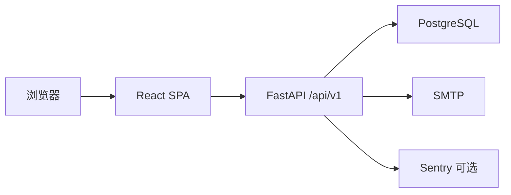

# 系统技术架构

后端是单进程 FastAPI 应用，挂载 `/api/v1` JSON 路由并把构建后的 React 静态资源挂在 `/`；前端是 Vite 构建的 SPA，通过生成的 axios 客户端访问同一域名的 API。数据落 PostgreSQL，邮件经 SMTP 发送，错误可选上报 Sentry，本地与自托管环境由 Docker Compose 编排。

## 1. 运行时分层与依赖拓扑



| 层 | 目录与文件 | 职责 | 修改红线 |
|---|---|---|---|
| 接入层 | `backend/app/main.py:21-36` | 创建 FastAPI、CORS、挂载路由与静态前端 | 不要在路由层直接拼 SQL |
| 路由与鉴权层 | `backend/app/api/main.py:6-14`、`backend/app/api/deps.py:16-57` | 注册路由、解析 Bearer Token、判定超级用户 | 不得绕过 `CurrentUser` 做资源归属判断 |
| 业务与持久化层 | `backend/app/crud.py:10-68`、`backend/app/models.py:13-126` | 用户/条目用例与 SQLModel 读写 | 写操作必须经过 `SessionDep` |
| 前端接入层 | `frontend/src/main.tsx:17-45` | 配置 API baseURL、Token 注入、路由与 QueryClient | 不要在组件内另建 axios 实例 |
| 运行编排层 | `compose.yml:20-71` | PostgreSQL、后端、Traefik、Mailpit 与健康检查 | 端口和域名走环境变量 |

## 2. 启动装配调用树

```text
backend/app/main.py:21 app = FastAPI(...)
  ├─ 18-19 [SENTRY_DSN 且非 development] sentry_sdk.init(dsn, enable_tracing=True)
  ├─ 27-33 CORSMiddleware(allow_origins=[FRONTEND_HOST])
  ├─ 35 include_router(api_router, prefix=API_V1_STR)
  │    └─ backend/app/api/main.py:7-10 login / users / utils / items
  │         └─ 13-14 [FASTAPI_ENV=development] private
  └─ 36 app.frontend("/", directory=backend/app/frontend)
```

前端启动时 `frontend/src/main.tsx:17-20` 读取 `VITE_API_URL` 作为 baseURL，并从 `localStorage` 注入 `access_token`；`frontend/src/main.tsx:31-38` 在 401/403 时清除 Token 并跳转登录页。静态产物由 `frontend/vite.config.ts:9-12` 写入 `backend/app/frontend`，随后被后端同域提供。

## 3. 跨切面机制

| 机制 | 实现位置 | 规则 |
|---|---|---|
| 认证 | `backend/app/api/deps.py:16-18`、`backend/app/core/security.py:22-26` | OAuth2 密码流，JWT 使用 HS256 与 `SECRET_KEY` |
| 密码存储 | `backend/app/core/security.py:11-16`、`backend/app/core/security.py:29-36` | Argon2 优先，bcrypt 兼容校验并在登录时升级哈希 |
| 配置 | `backend/app/core/config.py:14-91` | Pydantic Settings 从仓库根 `.env` 读取，非 development 拒绝默认占位密钥 |
| 数据访问 | `backend/app/core/db.py:7` | SQLModel engine，`pool_pre_ping=True`，迁移由 Alembic 管理 |
| 前端错误处理 | `frontend/src/main.tsx:22-30` | Query/Mutation 统一捕获 401/403 并清理会话 |

## 4. 运行形态与边界

本地开发可分别运行 Vite 与 FastAPI；生产由 `backend/Dockerfile:1-65` 先构建前端，再把 `backend/app/frontend` 复制进 Python 3.14 镜像，`CMD` 以 4 个 worker 运行。Compose 额外提供 Traefik、PostgreSQL 18、Adminer、Mailpit 与 Playwright 服务，见 `compose.yml:3-71`。

## 5. 共变耦合与修改清单

1. 改 API 前缀或路由：同步 `backend/app/main.py:35`、`backend/app/api/main.py:6-14`、生成的 `frontend/src/client` 与 [接口全集](../contracts/api-reference.md)。
2. 改前端构建目录：同步 `frontend/vite.config.ts:9-12`、`backend/app/main.py:36`、`backend/Dockerfile:54`。
3. 改鉴权：同步 `backend/app/api/deps.py:30-57`、`frontend/src/main.tsx:17-30` 与 [认证流程](../business/auth-and-users.md)。
4. 改配置项：同步 [配置手册](../contracts/configuration.md) 与 `compose.yml` 的注入列表。
